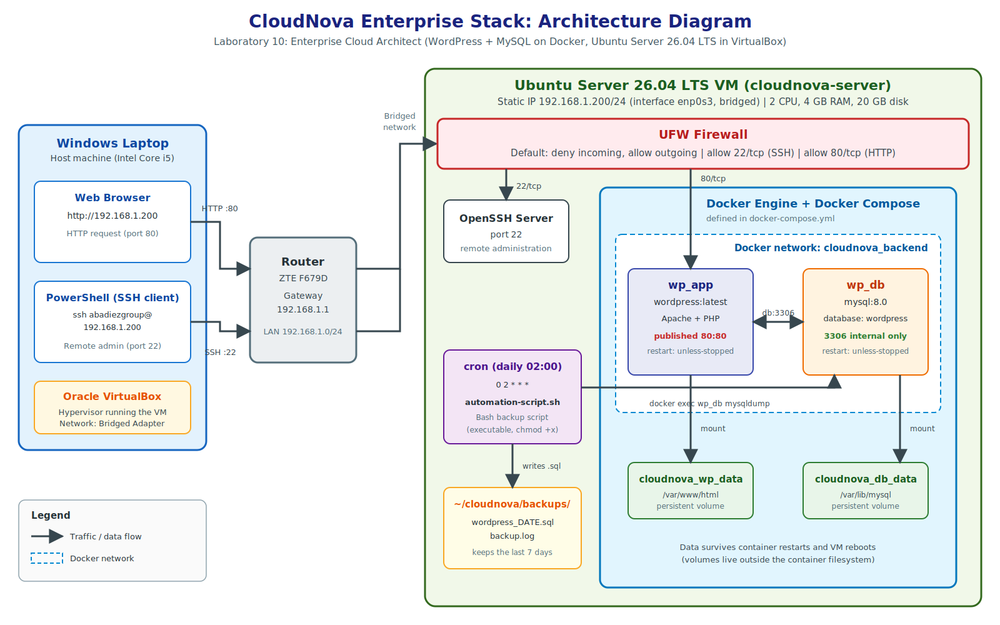

# Operational Manual: CloudNova Enterprise Stack
Handover manual for the client's IT team. It explains how to **deploy, secure, and maintain** the stack: WordPress and MySQL running as Docker containers on an Ubuntu Server VM, protected by a firewall and backed up automatically every day.

---

## 1. Overview

| Item | Value |
|------|-------|
| Application | WordPress (`wordpress:latest`) |
| Database | MySQL 8.0 (`mysql:8.0`) |
| Container platform | Docker Engine + Docker Compose |
| Server OS | Ubuntu Server 26.04 LTS |
| Hypervisor | Oracle VirtualBox (Bridged Adapter) |
| Server name | `cloudnova-server` (hostname `cloudnova`) |
| Static IP | `192.168.1.200/24` (gateway `192.168.1.1`) |
| Admin user | `abadiezgroup` |
| Firewall | UFW (default deny incoming; 22/tcp and 80/tcp allowed) |
| Automation | `automation-script.sh` scheduled by cron, daily at 02:00 |

## 2. Architecture



Traffic flow:

1. A user opens `http://192.168.1.200` in a browser. The request travels through the router to the VM.
2. UFW accepts only ports 22 and 80. Port 80 goes to the `wp_app` container.
3. `wp_app` talks to `wp_db` over the private Docker network `cloudnova_backend` (`db:3306`).
4. The database port is **not published** to the host, so it cannot be reached from outside the VM.
5. WordPress files and database files are stored in two named volumes, so they survive container restarts and VM reboots.

## 3. Prerequisites

- A computer able to run VirtualBox with hardware virtualization (VT-x) enabled
- Ubuntu Server 26.04 LTS ISO (`ubuntu-26.04-live-server-amd64.iso`)
- A VM with 2 CPUs, 2 to 4 GB RAM, and a 20 GB disk
- Internet access (to download packages and Docker images)
- A network where the VM can use the Bridged Adapter

## 4. Deployment

### 4.1 Create the VM

1. In VirtualBox choose **New**. Name: `cloudnova-server`, Type: Linux, Version: Ubuntu (64-bit), attach the ISO, and tick **Skip Unattended Installation**.
2. Set 2 CPUs and 2048 to 4096 MB memory, and a 20 GB disk.
3. Under **Settings > Network > Adapter 1** choose **Bridged Adapter** and select the physical network adapter.
4. Start the VM and run the Ubuntu Server installer. Keep the default (non-minimized) install, use the whole disk, create the admin user, and tick **Install OpenSSH server**. Skip the featured snaps.
5. Reboot and remove the installation medium when asked.

### 4.2 Set a static IP

DHCP can hand the VM a different address after a reboot, which breaks SSH and bookmarks. Configure a fixed address with netplan.

```bash
ls /etc/netplan/
sudo cp /etc/netplan/00-installer-config.yaml /etc/netplan/00-installer-config.yaml.bak
sudo nano /etc/netplan/00-installer-config.yaml
```

Contents of the file (use spaces, not tabs):

```yaml
network:
  version: 2
  ethernets:
    enp0s3:
      dhcp4: false
      addresses:
        - 192.168.1.200/24
      routes:
        - to: default
          via: 192.168.1.1
      nameservers:
        addresses: [8.8.8.8, 1.1.1.1]
```

Stop cloud-init from overwriting the file, then apply it. Do this from the VM console, because the SSH session will drop when the address changes.

```bash
echo "network: {config: disabled}" | sudo tee /etc/cloud/cloud.cfg.d/99-disable-network-config.cfg
sudo netplan apply
ip a
ping -c 3 google.com
```

Reconnect from the host with `ssh abadiezgroup@192.168.1.200`.

Set the server timezone so that cron times match local time:

```bash
sudo timedatectl set-timezone Asia/Manila
```

### 4.3 Update the system and install Docker

```bash
sudo apt update && sudo apt upgrade -y
sudo apt install -y docker.io docker-compose-v2
sudo systemctl enable --now docker
sudo usermod -aG docker $USER
exit
```

Log in again so the group change takes effect, then verify:

```bash
docker --version
docker compose version
docker run hello-world
```

### 4.4 Deploy the stack

```bash
mkdir -p ~/cloudnova && cd ~/cloudnova
# place docker-compose.yml and automation-script.sh in this folder
docker compose up -d
docker compose ps
```

`docker-compose.yml` defines two services (`db` and `wordpress`), one private network (`backend`, created as `cloudnova_backend`), and two named volumes (`db_data` and `wp_data`). Both containers use `restart: unless-stopped`, so they start again automatically after a reboot.

Passwords are read from environment variables, with demo defaults when no `.env` file exists. **For real use, create a `.env` file next to the compose file and set strong values:**

```
MYSQL_ROOT_PASSWORD=<strong password>
MYSQL_PASSWORD=<strong password>
```

Never commit a real `.env` file to GitHub.

### 4.5 Verify and finish the WordPress setup

Open `http://192.168.1.200` in a browser. Choose the language, set the site title, and create the admin account. The site and its admin bar should load.

### 4.6 Persistence test

```bash
sudo reboot
```

After about a minute, reconnect by SSH and check:

```bash
cd ~/cloudnova
docker compose ps
docker volume ls
```

Both containers should be `Up` (their CREATED time is unchanged, so they were restarted, not rebuilt), the volumes `cloudnova_db_data` and `cloudnova_wp_data` should be listed, and the WordPress site should still show the same content.

### 4.7 Deploy from this repository on a fresh host

```bash
git clone <repository-url>
cd <repository>/Laboratory-10-Enterprise-Cloud-Architect
docker compose up -d
docker compose ps
```

This works without a `.env` file because the compose file contains demo defaults.

## 5. Security

### 5.1 Firewall (UFW)

```bash
sudo ufw default deny incoming
sudo ufw default allow outgoing
sudo ufw allow 22/tcp
sudo ufw allow 80/tcp
sudo ufw enable
sudo ufw status verbose
```

Expected result: `Status: active`, `Default: deny (incoming), allow (outgoing)`, with `22/tcp` and `80/tcp` allowed (IPv4 and IPv6).

Always allow port 22 **before** running `ufw enable`; otherwise the SSH session will be cut off and the server will be unreachable remotely.

### 5.2 Design decisions

- **Default deny:** everything that is not explicitly allowed is blocked.
- **Only two open ports:** 22 for administration and 80 for the website.
- **Database not exposed:** the `db` service has no `ports:` entry. Docker publishes ports with its own iptables rules, which can bypass UFW, so the safest approach is to not publish the database at all. It is reachable only from `wp_app` over the internal network.
- **No secrets in the backup script:** the script reads the MySQL root password from inside the container.
- **Secrets in Git:** the real `.env` is never committed. The demo passwords in the compose file must be replaced in production.
- **Recommended hardening for production:** HTTPS with a certificate, SSH key authentication instead of passwords, and limiting SSH to trusted addresses (`sudo ufw allow from <trusted-ip> to any port 22`).

## 6. Automation

`automation-script.sh` backs up the WordPress database.

What it does:

1. Resolves its own folder, so it works from any location.
2. Creates `backups/` if it does not exist.
3. Runs `mysqldump` inside the `wp_db` container and writes `wordpress_<date>_<time>.sql`.
4. Deletes backups older than 7 days.
5. Appends a line to `backups/backup.log`.

Make it executable and test it once:

```bash
chmod +x automation-script.sh
./automation-script.sh
ls -l backups/
cat backups/backup.log
```

The warning `Using a password on the command line interface can be insecure` is expected and harmless: the password only exists inside the container.

Schedule it with cron:

```bash
crontab -e
```

```
0 2 * * * /home/abadiezgroup/cloudnova/automation-script.sh
```

This runs the backup every day at 02:00 (server time, set to Asia/Manila). Check the schedule with `crontab -l`. To demonstrate the job quickly, temporarily change the schedule to `* * * * *` (every minute), watch `backups/backup.log`, and then restore the daily schedule.

## 7. Backup and Restore

**Manual backup:**

```bash
cd ~/cloudnova
./automation-script.sh
```

**Restore a backup:**

```bash
cd ~/cloudnova
ls backups/
docker exec -i wp_db sh -c 'mysql -u root -p"$MYSQL_ROOT_PASSWORD" wordpress' < backups/wordpress_<DATE>_<TIME>.sql
```

Reload the website to confirm the content is back. Also copy backups to another machine regularly, because a backup that lives only on the same VM does not protect against losing the VM.

## 8. Maintenance

| Task | Command |
|------|---------|
| Check container status | `docker compose ps` |
| View logs | `docker compose logs -f` |
| Stop the stack (data is kept) | `docker compose down` |
| Start the stack | `docker compose up -d` |
| Update images | `docker compose pull && docker compose up -d` |
| Check firewall | `sudo ufw status verbose` |
| Check disk space | `df -h` and `docker system df` |
| Update the OS | `sudo apt update && sudo apt upgrade -y` |
| Safe shutdown of the VM | `sudo poweroff` |

Warning: `docker compose down -v` deletes the volumes and **all WordPress and database data**. Do not use `-v` unless that is intended.

## 9. Troubleshooting

| Problem | Cause | Fix |
|---------|-------|-----|
| VM IP changed after reboot, SSH to the old address fails | DHCP assigned a new address | Set a static IP with netplan (section 4.2) |
| Router would not allow a DHCP reservation | The ISP router's user account hides the LAN/DHCP settings | Configure the static IP inside Ubuntu instead of on the router |
| `Connection refused` on SSH right after a reboot | The VM is still booting | Wait one minute and try again |
| `Login incorrect` and the password is forgotten | Wrong or lost password | Reset it from GRUB: press `e` on the Ubuntu entry, append `init=/bin/bash` to the `linux` line, boot with Ctrl+X, run `mount -o remount,rw /`, `passwd <user>`, then `exec /sbin/init` |
| SSH stops working after enabling UFW | Port 22 was not allowed first | From the VM console run `sudo ufw allow 22/tcp` |
| Site does not open | Container stopped or port 80 blocked | `docker compose ps`, then `docker compose up -d`; check `sudo ufw status` |
| Backup script fails with `bad interpreter` | The file was saved with Windows line endings | Edit it on Linux with `nano`, or run `sed -i 's/\r$//' automation-script.sh` |
| Cron runs at the wrong hour | Server was in UTC | `sudo timedatectl set-timezone Asia/Manila` |
| Backup file is empty | `wp_db` is not running | Start the stack, then run the script again |


